# 🛍️ EcomAdmin – E-commerce Admin Dashboard
 
EcomAdmin is a clean, responsive admin dashboard for managing an online store. It brings sales analytics, products, orders, customers, 

support tickets, team chat, projects, hiring boards and a calendar into one workspace.
 
 
## 📸 Screenshots
 
| Login | Dashboard |

|:---:|:---:|

| 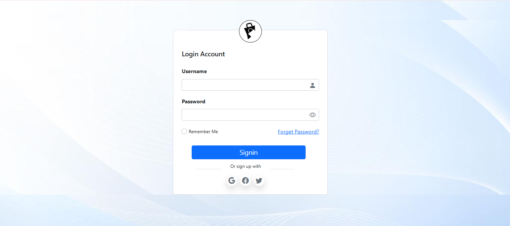 | 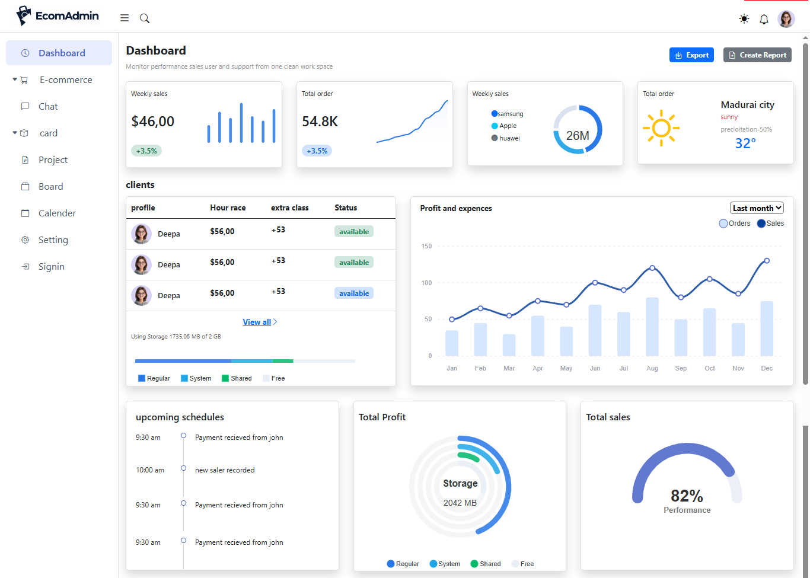 |
 
| Orders Overview | Products |

|:---:|:---:|

| 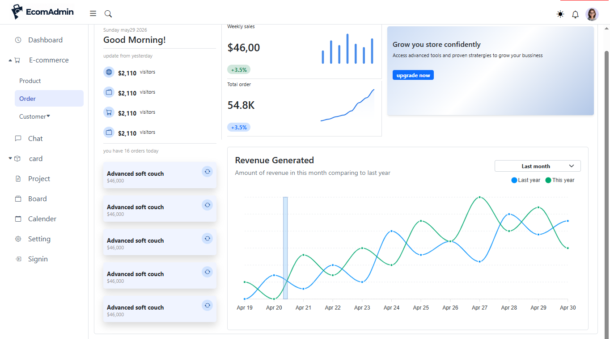 | 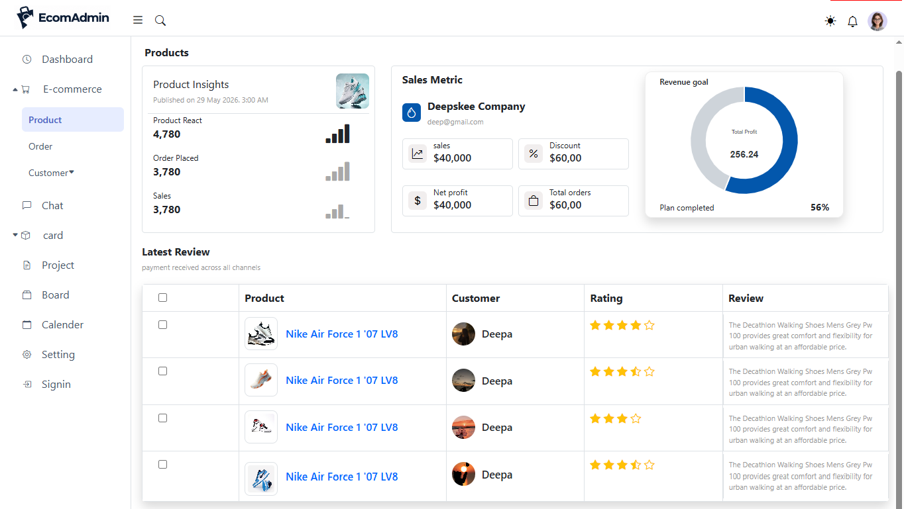 |
 
| All Customers | Customer Details |

|:---:|:---:|

| 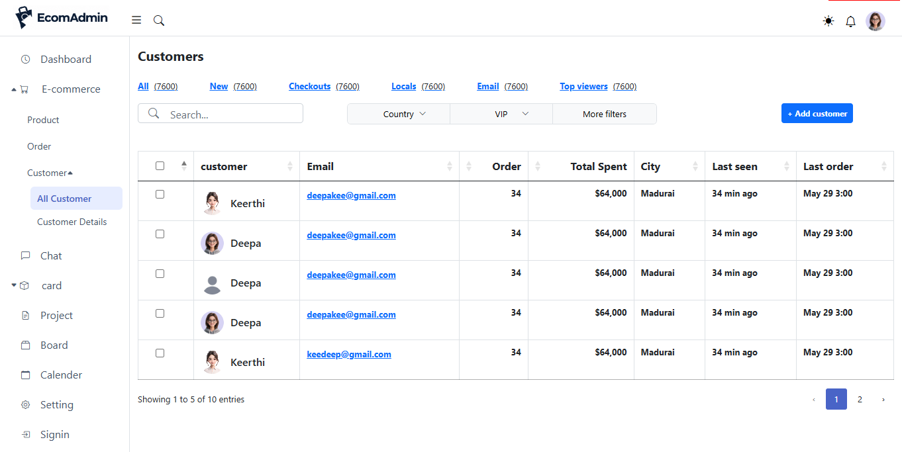 | 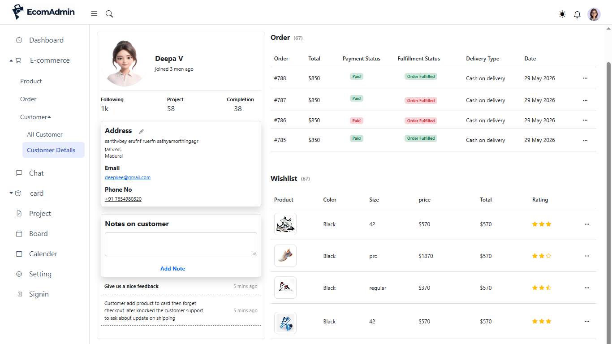 |
 
| Chat | Card View (Tickets) |

|:---:|:---:|

| 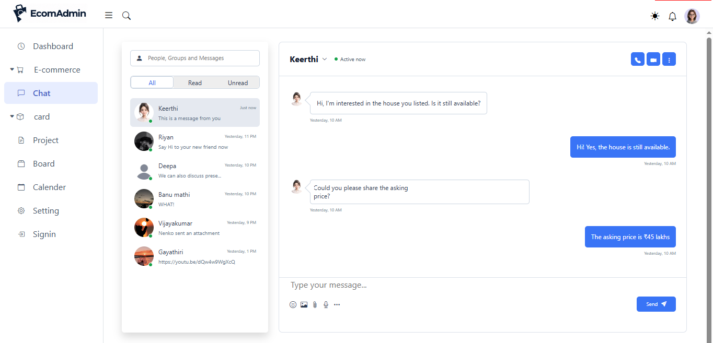 | 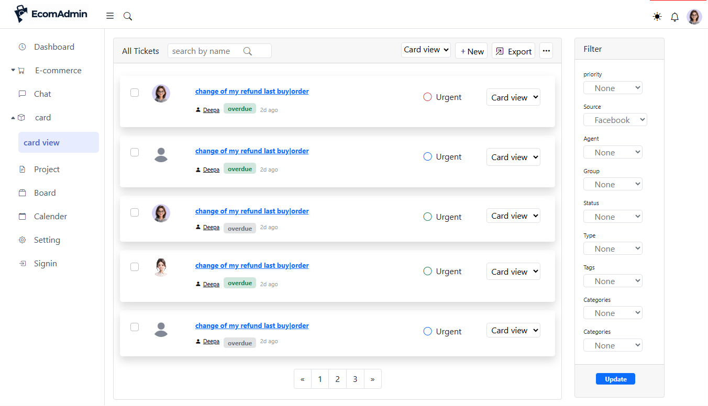 |
 
| Project List | Kanban Board |

|:---:|:---:|

| 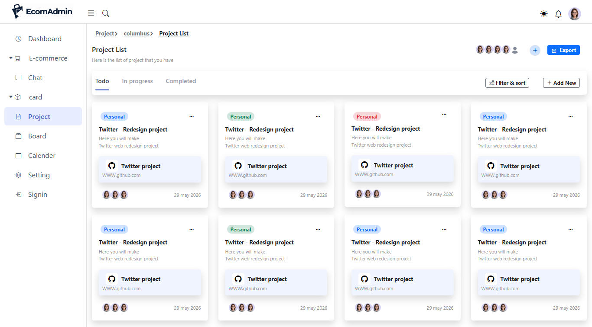 | 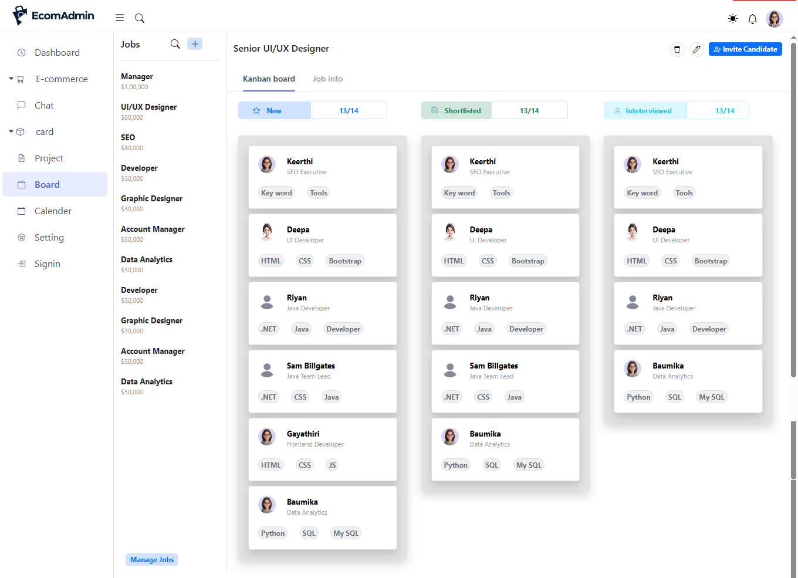 |
 
| Calendar | Settings |

|:---:|:---:|

| 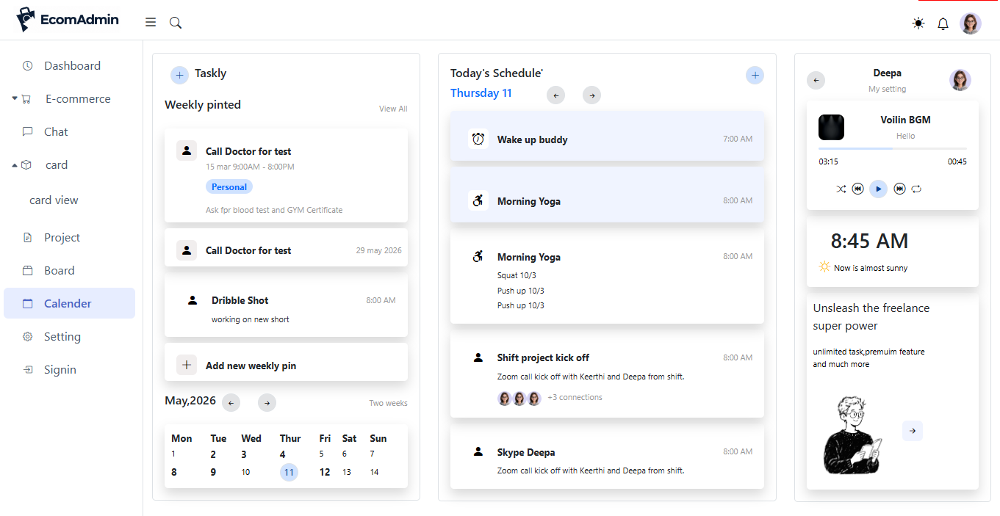 | 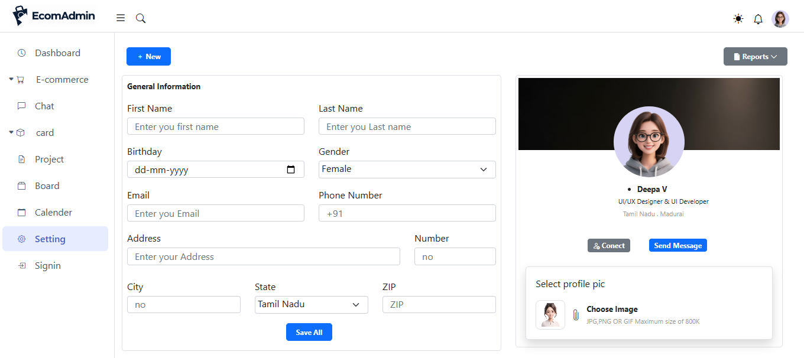 |
 
 
## ✨ Features
 
- **Login page** – username/password sign-in with show/hide password, "Remember me", forgot password link and social sign-up options (Google, Facebook, Twitter).

- **Dashboard** – weekly sales, total orders, sales by brand, weather widget, client list, profit & expenses chart, upcoming schedules, storage usage and performance gauge.

- **Orders overview** – daily greeting, visitor stats, today's orders and a "Revenue Generated" chart comparing this year with last year.

- **Products** – product insights, sales metrics, revenue goal progress and a latest reviews table with ratings.

- **Customers** – DataTables-powered customer table with search, column sorting, filters (country, VIP, more), pagination and an *Add customer* button.

- **Customer details** – profile, address, contact info, notes, order history and wishlist.

- **Chat** – conversation list with All / Read / Unread filters, message thread, call and video buttons, emoji, image and file attachments.

- **Card view (tickets)** – ticket list with priority, status, search, export and a filter panel.

- **Projects** – project cards organised in Todo / In progress / Completed tabs with filter & sort.

- **Kanban board** – hiring pipeline (New → Shortlisted → Interviewed) with a jobs sidebar and candidate cards.

- **Calendar** – weekly pins, daily schedule, mini calendar, music player and clock widgets.

- **Settings** – profile form (name, birthday, gender, email, phone, address) and profile picture upload.

- **Light/dark mode toggle**, notifications and a collapsible sidebar.
 
 
## 🧰 Tech Stack
 
- HTML5

- CSS3

- Bootstrap 5

- JavaScript

- jQuery & [DataTables](https://datatables.net/) (searchable, sortable, paginated tables)

- [ApexCharts](https://apexcharts.com/) (sales, revenue and profit charts)

- Font Awesome / Bootstrap Icons
 
 
## 📁 Project Structure
 
Ecom-Admin-ui/

├── Layout.html           

├── dashboard.html

├── product.html

├── order.html

├── customers.html

├── customer-details.html

├── chat.html

├── card-view.html

├── project.html

├── board.html

├── calendar.html

├── setting.html

├── assets/

│   ├── css/

│   ├── js/

│   └── images/

├── screenshots/         

└── README.md
 
 
## 🚀 Getting Started
 
### Installation
 
# 1. Clone the repository

git clone https://github.com/deepavijayakumar2005-dev/Ecom-Admin-ui.git

# 2. Go to the project folder

cd Ecom-Admin-ui
 
 
## 🧭 Navigation
 
| Menu | Description |

|---|---|

| Dashboard | Sales, orders and performance overview |

| E-commerce → Product | Product insights and reviews |

| E-commerce → Order | Orders and revenue overview |

| E-commerce → Customer | All customers and customer details |

| Chat | Messaging |

| Card → Card view | Support tickets |

| Project | Project list |

| Board | Kanban hiring board |

| Calendar | Schedule and pinned tasks |

| Setting | Profile settings |

| Signin | Login page |
 
 
## 📄 License
 
This project is licensed under the [MIT License](LICENSE).
 
---
 
## 👩‍💻 Author
 
**Deepa V** – UI/UX Designer & UI Developer, Madurai, Tamil Nadu
 
- GitHub:https://github.com/deepavijayakumar2005-dev/Ecom-Admin-ui

- Email: deepavijayakumar2005@gmail.com
 
⭐ If you like this project, give it a star!
 
